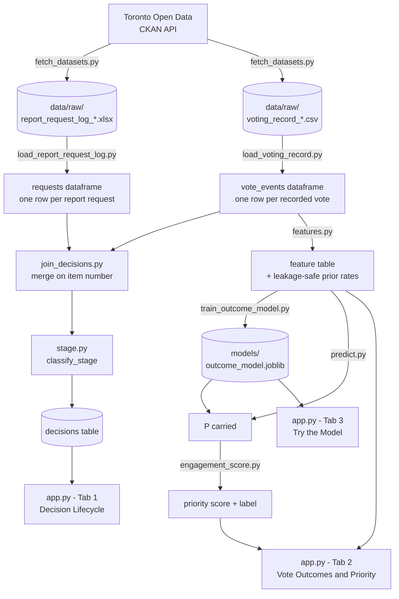

# Architecture

This explains exactly what runs, in what order, and how every piece connects — from the raw files on Toronto's Open Data portal to the dashboard on your screen. If you just want to *run* the project, see the [README](../README.md). This is the "why does it work this way" document.

## One paragraph

Two City of Toronto datasets — a log of staff **report requests** and a log of **recorded council votes** — share a common item-number format (e.g. `2023.CC1.2`), so they can be joined even though neither dataset was designed to talk to the other. The pipeline downloads both, cleans their real (messy) schemas, joins them on that item number, and tags every report request with a lifecycle stage. Separately, the voting data alone trains a model that predicts how likely a *contested* vote is to pass, which gets turned into an "engagement priority" score — close calls rank high, landslides rank low. A Streamlit app puts both on screen.

## System diagram

## The two source datasets, and why they can be joined at all

Neither dataset was built to reference the other, but both use the City Clerk's agenda item numbering scheme: `<year>.<committee-code><sequence>.<item>`, e.g. `2023.IE5.1`. That string is the *only* thing connecting them:

- **Report Request Log** (`report_request_log_*.xlsx`) — one row per staff report ever requested by Council or a committee. Its `Item Number` is the item that *asked* for the report. Verified live via the CKAN API; see [`docs/data_dictionary.md`](data_dictionary.md) for the full column mapping.
- **Voting Record** (`voting_record_*.csv`) — one row per councillor per recorded vote. Its `Agenda Item #` is the item a vote actually happened on. **Only recorded votes appear here** — the dataset's own description says so — so most routine council business (passed on a no-vote consent agenda) is simply absent from this file, not "undecided."

These are *different items most of the time*. A report gets requested on item A; months later the report comes back on a different item B, and B is what actually gets voted on. The Report Request Log's `Closed by` field is what links A → B — except it's overloaded (see below), which is why `join_decisions.py` exists as its own module instead of a one-line merge.

## Layer by layer

### 1. Ingest — `src/ingest/`

| File | What it does |
|---|---|
| `toronto_open_data.py` | A ~50-line CKAN API client: `get_package()` fetches a dataset's metadata and resource list by slug; `find_resource()` locates one resource by a substring of its filename; `download_resource()` saves it. Nothing Toronto-specific except the base URL — this would work for any CKAN portal. |
| `fetch_datasets.py` | Calls the client twice (once per dataset) and saves the current term's files into `data/raw/`. This is the only thing that talks to the network. |

`config.py` at the repo root holds the CKAN package slugs and the current term string (`2022-2026`) — bump that constant if the term rolls over.

### 2. Pipeline — `src/pipeline/`

**`load_report_request_log.py`** reads the XLSX and normalizes two fields that are trickier than they look:
- `Status` isn't `Open`/`Closed` — the real values are `NCF` (pending) and `closed`/`Closed`/`CLOSED` (three casings). `is_open` is derived as "not a closed variant," not "equals NCF," so it's robust to any casing.
- `Closed by` holds *either* a date *or* one-or-more follow-up item numbers, with no column telling you which. `_split_closed_by()` regex-matches item-number shapes first; anything left over is parsed as a date.

**`load_voting_record.py`** reads the CSV (one row per councillor per vote) and collapses it to one row per *vote event* (one row per motion, shared by every councillor who voted on it). Two things worth knowing:
- `parse_result()` turns the free-text `Result` column (e.g. `"Carried, 25-1"`, `"Lost (tie), 11-11"`) into structured `outcome`/`yes_count`/`no_count` fields via a regex validated against **all 252** distinct values actually present in the current-term file — not a guessed pattern.
- **`event_seq`**, not `vote_datetime`, is the authoritative ordering signal. `Date/Time` is missing (`NaT`) for 65% of all vote events — 83% of City Council-level ones specifically, which are the majority of the dataset. `_id` (the raw CSV's row order) is verified monotonically chronological everywhere it can be checked against a known timestamp (zero violations across 10,418 comparisons), because rows are appended to the source file in the order the Clerk recorded them. `event_seq` is just the minimum `_id` per vote event, and every module downstream that needs "what happened in what order" sorts by it instead of by the frequently-missing `vote_datetime`.

**`join_decisions.py`** merges the two cleaned tables:
1. For each follow-up item, take the `event_seq`-*last* recorded vote as that item's effective final outcome (an item can have several vote events — an amendment, a competing motion, then the main motion — and only the last one reflects what actually happened).
2. For each report request, resolve `closed_by_item_ids` to a single `followup_item_id` where there's exactly one (if there are several, it's flagged `has_multiple_followups` rather than guessed).
3. Left-merge the two on that follow-up item ID.

**`stage.py`** turns the merged table into one of six human-readable lifecycle stages, purely from fields that are already structured (no NLP needed):
`requested` → `report_delivered` → `decided_carried` / `decided_not_carried`, plus two edge cases: `closed_without_item` (closed administratively, no new item) and `ambiguous_multi_item` (multiple follow-ups, needs a human to disambiguate).

### 3. Model — `src/model/`

**`features.py`** builds the predictor's feature table from vote events, sorted by `event_seq`. For each event it computes that committee's and that motion type's historical carry rate as an *expanding, shifted* average — i.e., only votes strictly before the current one count toward its "prior rate," so the model never sees its own outcome or a future one. This is what makes the later train/test split meaningful instead of leaking information backward in time.

**`train_outcome_model.py`** splits the feature table by *position* (first 80% train, last 20% test) rather than randomly — a random split would let future committee carry-rate information leak into training, since those rates are computed over the whole table. It one-hot-encodes `committee`/`motion_type`/`term` and feeds everything into a `LogisticRegression(class_weight="balanced")`. The `balanced` weighting is deliberate: it trades away raw 0.5-threshold accuracy (which a model that just always predicts "carried" would win trivially, since ~86% of recorded votes carry) in exchange for probabilities that actually separate close votes from landslides — which is the whole point, since the output feeds `engagement_score.py`, not a pass/fail classifier. **AUC is the metric that matters here, not accuracy** — currently ≈0.81 on the current term.

**`engagement_score.py`** is a pure function of the model's probability: `priority = 1 - |p - 0.5| * 2`. A 95%-likely-to-pass item and a 5%-likely-to-pass item both score low (both are foregone conclusions, just in opposite directions); a 50/50 item scores 1.0. This is the actual translation from "the model's output" to "why a resident should care."

**`predict.py`** applies a saved model to new rows. Important limitation: it needs `motion_type`, which — unlike `committee` — usually **isn't known until the vote actually happens**. For a genuinely upcoming item, you'd pass `motion_type="Unknown"`; the model's `OneHotEncoder(handle_unknown="ignore")` then contributes nothing for that feature, so the prediction quietly falls back to a committee-only estimate rather than erroring.

### 4. Application — `app.py`

A single-file Streamlit dashboard, three tabs, no separate API or database — it imports the pipeline/model functions directly and wraps them in `@st.cache_data`/`@st.cache_resource` so the heavy joins and model loads happen once per session, not per interaction.

- **Decision Lifecycle** calls `stage.add_stage(join_decisions.build_decisions_table(...))` and renders it as a filterable table + bar chart.
- **Vote Outcomes & Priority** calls `features.build_feature_table()`, runs the saved model's `predict_proba` over it, and ranks by `engagement_score.add_engagement_priority()`.
- **Try the Model** is the interactive version of `predict.py` — dropdowns for committee/motion type/term, wired straight to the same model object.

If the raw files or trained model are missing, buttons in the UI call `fetch_datasets.main()` / `train_outcome_model.train()` directly — the dashboard can bootstrap itself without the CLI.

## Worked example: one decision, start to finish

Item `2023.IE1.11`, "Net Zero Actions Update" — picked because it touches every layer, including a subtlety the `event_seq` fix (above) exists because of. It's also a good example of a quirk worth knowing before treating `item_id` as a unique key: this one parent item actually contains **four separate numbered directives**, each its own row in the Report Request Log, each independently resolved to its own follow-up item (three resolve to `2023.IE3.3`; the fourth — traced below — resolves to `2023.IE5.1`). `item_id` identifies the agenda item a request was made on, not a single request.

1. **Report Request Log, directive #3 under `2023.IE1.11`**: requested by the Infrastructure and Environment (IE) committee. `Directive`: *"Directed the City Manager to report back to the April 26, 2023 meeting of Infrastructure and Environment Committee with a plan to implement a ban on use of two-stroke engine leaf blowers, lawnmowers and other small engine equipment..."* `Closed by`: `2023.IE5.1` (a single item number, not a date) → `closed_by_item_ids = ["2023.IE5.1"]`, `followup_item_id = "2023.IE5.1"`.
2. **Voting Record, rows for `2023.IE5.1`**: three separate vote events on this one follow-up item —
   | event_seq (≈ `_id`) | committee | motion_type | result |
   |---|---|---|---|
   | 8508 | IE Committee | Amend Item (Additional) | Carried, 5-1 |
   | 8878 | City Council | Receive Item | **Lost, 6-18** |
   | 8904 | City Council | Adopt Item | **Carried, 20-5** |

   Council first voted down a motion to merely *receive* the item (which would have sidestepped adopting its recommendations), then adopted it outright. Both City-Council-level rows have a missing `Date/Time` — this is exactly the case `event_seq` was added to handle correctly; sorting by the (missing) timestamp instead would tie-break alphabetically (`"Adopt Item" < "Receive Item"`) and record the *opposite* of what happened.
3. **`join_decisions.build_decisions_table()`** takes the `event_seq`-last event (`Adopt Item`, carried) as `followup_final_outcome = "carried"`.
4. **`stage.classify_stage()`**: status is closed, has exactly one follow-up item, that item has a recorded outcome → stage = `decided_carried`.
5. **On the model side**, this item's three vote events each got their own row in the feature table (one per motion), each with that committee's/motion type's prior carry rate as of that point in the sequence, and each contributes to training the outcome model independently of the lifecycle join above — the two sides of the pipeline share the same source vote events but serve different purposes (lifecycle tracking vs. outcome prediction).
6. **In the dashboard**, this item shows up in Tab 1 with stage `decided_carried`; its three underlying vote events show up in Tab 2 with the model's retrospective P(carried) next to what actually happened.

## Design decisions, and why

| Decision | Why |
|---|---|
| Rule-based lifecycle stages, not ML | The fields needed (`Status`, presence of a follow-up item, presence of a vote) are already structured. NLP is for the parts that are genuinely unstructured — the `directive` text, the ward lookup — not this. |
| `event_seq` over `vote_datetime` for ordering | Verified both (a) `vote_datetime` is NaT for the majority of events and (b) `_id` is monotonically chronological wherever checkable. Using the unreliable field would silently corrupt both lifecycle outcomes and the model's leakage-safe training order. |
| Time-split train/test, not random | A random split lets a vote's own future (via the committee's overall carry rate, computed over the whole dataset) leak into its own features. Position-based split + shifted expanding averages avoids this. |
| `class_weight="balanced"`, evaluated on AUC not accuracy | ~86% of recorded votes carry, so a model that always predicts "carried" wins 86% accuracy while being useless for the actual goal (separating toss-ups from foregone conclusions). AUC measures that separation; accuracy doesn't. |
| Dashboard imports pipeline code directly, no API layer | For a project this size, a FastAPI layer between Streamlit and the pipeline would add a serialization boundary for no real benefit — everything runs in one process already. Worth revisiting only if a second frontend needs the same logic. |

## Known limitations (and where they'd be fixed)

- **Report Request Log only covers the 2018-2022 and 2022-2026 terms**; the Voting Record goes back to 2006. The lifecycle tracker is limited to the newer terms; the model could use more historical terms than it currently does (only the current term is wired into `train()` by default).
- **`motion_type` isn't known before a vote happens**, so `predict.py`/Tab 3 can't give a true forward forecast for a not-yet-voted item — only a committee-only fallback estimate. A real "will this pass" forecast for pending items would need a different feature set, built from what's actually knowable in advance.
- **No ward/geography field in either dataset.** Mapping a decision to "does this affect my neighbourhood" needs a third data source (a councillor-to-ward lookup is easy; geocoding free-text item titles is not, and is out of scope here).
- **`ambiguous_multi_item`** (54 requests closed by more than one follow-up item) isn't resolved automatically — a human, or a smarter heuristic, would need to pick which follow-up actually settled the request.
- **`item_id` is not a unique key in the Report Request Log** (see the worked example above) — one agenda item commonly contains several independently-numbered directives, each its own row with its own `Closed by` resolution. Code that does `requests_df[requests_df["item_id"] == x]` should expect multiple rows back, not one.
